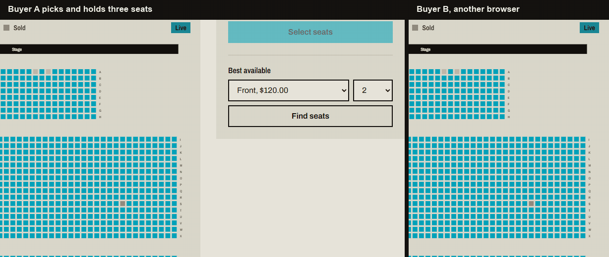
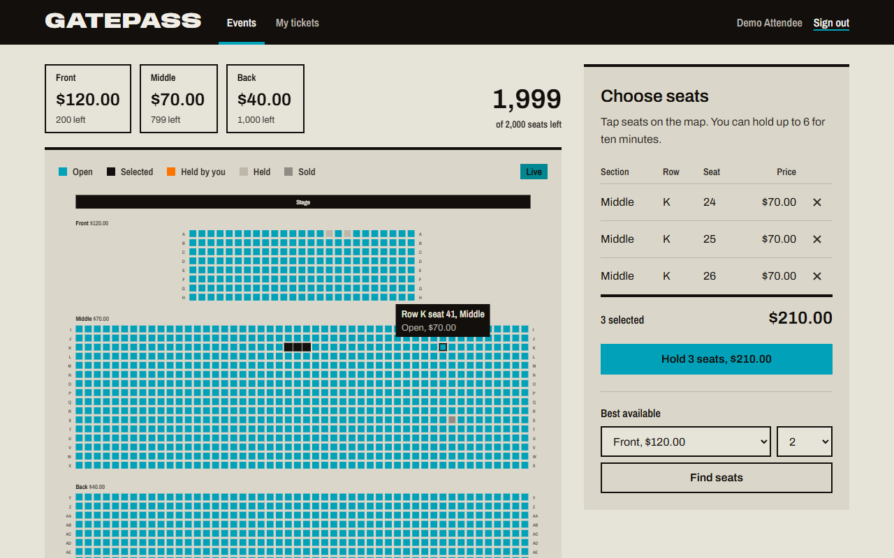
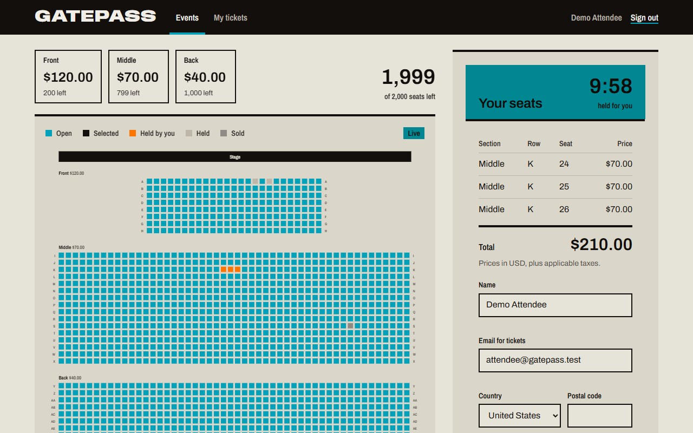
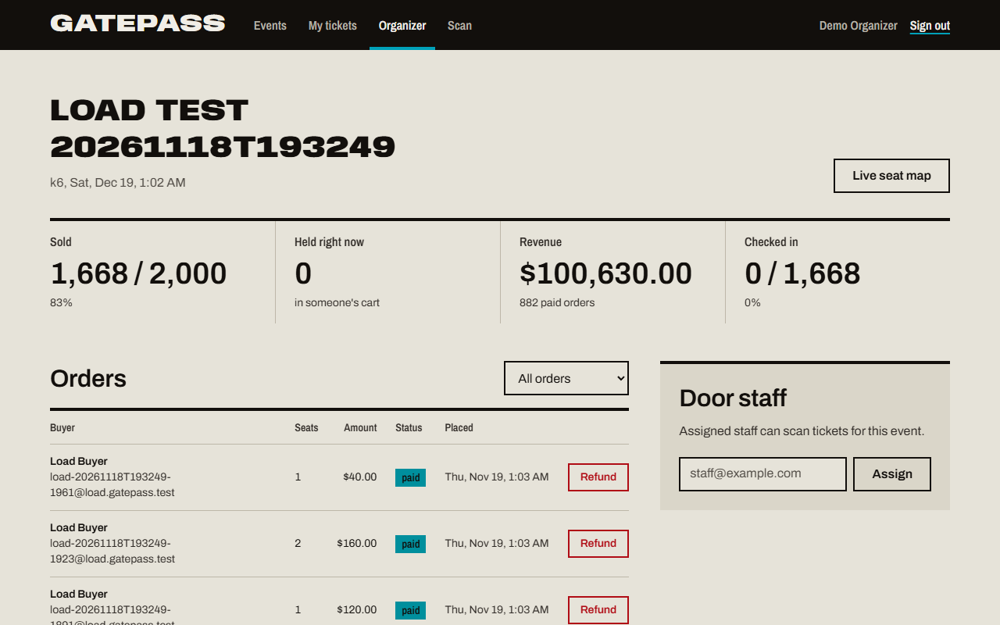
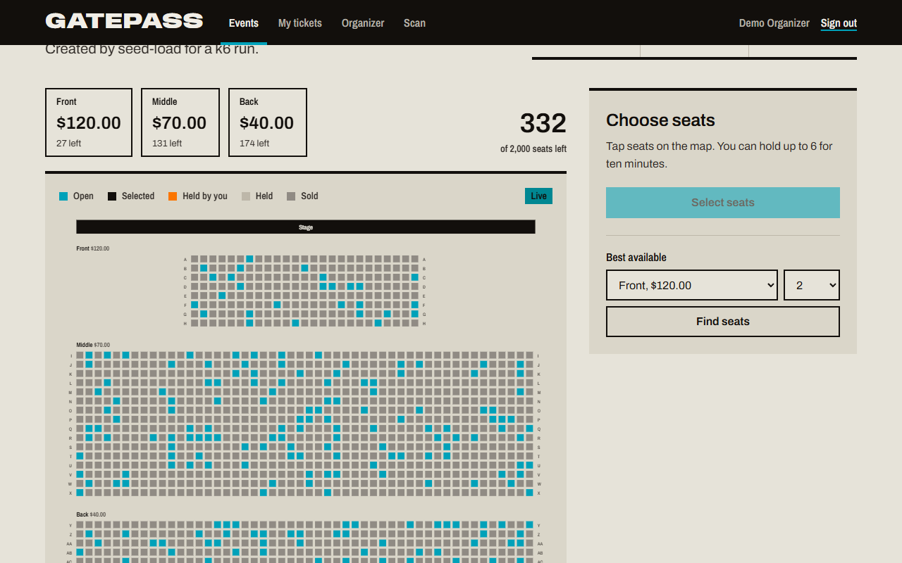
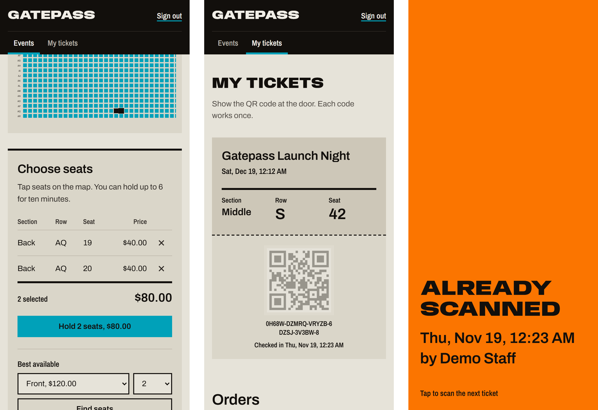
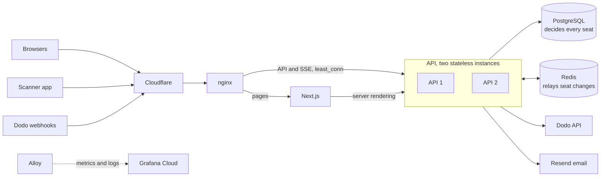
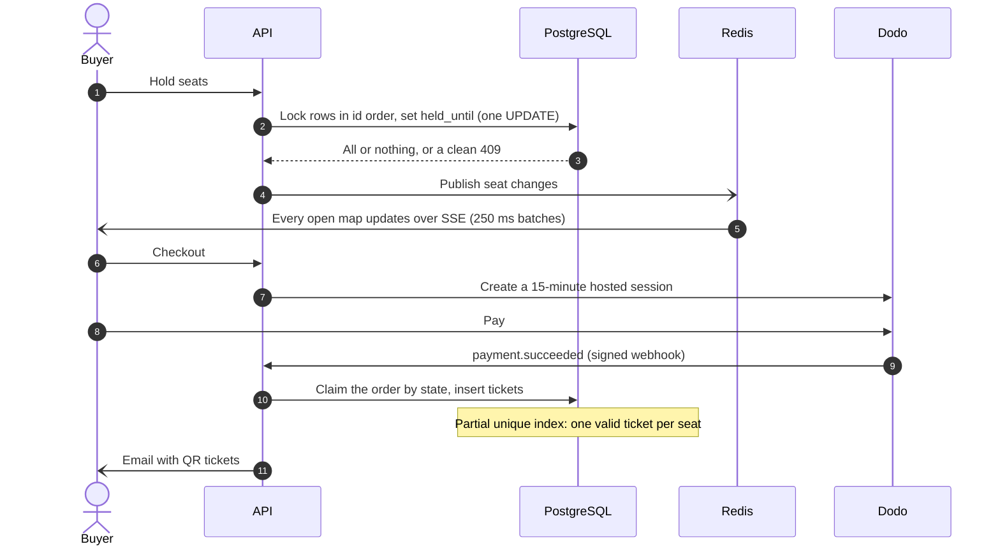
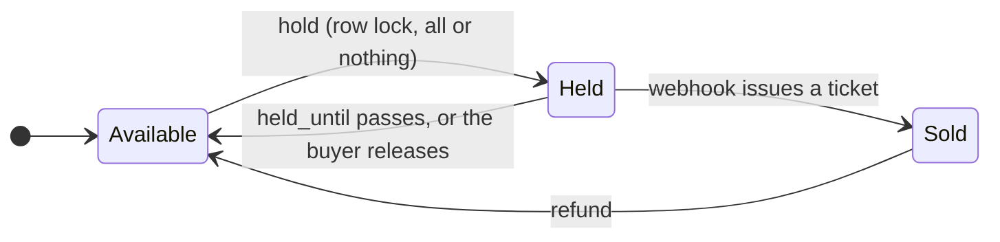

# Gatepass

**Reserved-seat ticketing for the moment a show goes on sale.** Thousands of buyers reach for the same seats in the same second, and every seat is sold exactly once.

[](https://github.com/Navraj86/gatepass/actions/workflows/release.yml)

**Live:** [gatepass.navraj.dev](https://gatepass.navraj.dev), with payments in Dodo Payments test mode, so no real money moves. Sign in with password `gatepass` as `attendee@gatepass.test` (buy seats), `organizer@gatepass.test` (create events, watch sales) or `staff@gatepass.test` (scan tickets).

<p align="center">
  
</p>
<p align="center"><sub>Two buyers in two browsers. When buyer A holds three seats, they flash and turn taken on buyer B's map about a third of a second later. Had both clicked Hold at once, PostgreSQL would have given the seats to exactly one of them.</sub></p>

## At a glance

|                |                                                                                                                                                                     |
| -------------- | ------------------------------------------------------------------------------------------------------------------------------------------------------------------- |
| **Problem**    | An on-sale is a thundering herd on a few thousand rows. The naive version oversells, deadlocks, or charges people for seats they never get.                         |
| **Guarantee**  | Zero oversells, enforced by PostgreSQL itself (row locks plus a partial unique index) and covered by nine concurrency tests that run against real PostgreSQL in CI. |
| **Product**    | A live seat map, ten-minute holds, hosted checkout, emailed QR tickets, an organizer dashboard, and a scanner for the door on the web and as a native app.          |
| **Stack**      | TypeScript end to end: Next.js 16 and React 19, Expo and React Native, Express 5, PostgreSQL 17, Redis 8, Drizzle, Zod, Better Auth, Dodo Payments, Resend.         |
| **Operations** | Two API instances behind nginx, rolling deploys with no downtime, Prometheus metrics with Grafana alerts, nightly backups.                                          |

## The product

**Buyers** pick seats on a map that updates live, see section, row, seat and price side by side, and hold up to six seats for ten minutes while they pay.

| Choosing seats                                                                                                                                     | Seats held, paying                                                                         |
| -------------------------------------------------------------------------------------------------------------------------------------------------- | ------------------------------------------------------------------------------------------ |
|  |  |

**Organizers** create events, lay out priced sections, publish, watch sales and refund orders. The screenshots below are from right after the local load test: 5,000 simulated buyers in 30 seconds left 1,668 seats sold to 882 paid orders, and not one seat sold twice.

| Sales dashboard                                                                                        | The same event's public map                                                                                       |
| ------------------------------------------------------------------------------------------------------ | ----------------------------------------------------------------------------------------------------------------- |
|  |  |

**Door staff** scan tickets with a phone camera. A code turns green once; any later scan shows when it was first used and by whom.

<p align="center">
  
</p>

## Proven, not promised

| Scenario                                                  | Result                                                                   |
| --------------------------------------------------------- | ------------------------------------------------------------------------ |
| 200 parallel holds on one seat (CI test C1)               | 1 success, 199 clean `409 Conflict` responses                            |
| The same payment webhook delivered 10 times at once (C4)  | 1 paid order, 1 ticket per seat, 1 email                                 |
| 50 parallel scans of one ticket (C6)                      | Exactly 1 green                                                          |
| 500 buyers in 10 s, buying for real (one laptop)          | 0 failed requests, hold p50 203 ms and p95 529 ms                        |
| The same run plus 500 live map viewers                    | 0 disconnects; update lag 343 ms on average, including 250 ms batching   |
| 5,000 buyers in 30 s against one API process (one laptop) | The process saturated near 270 req/s, and still every audit check read 0 |
| A rolling deploy under steady load (local)                | 8,328 requests, 0 errors                                                 |

Every load run ends with [`load/audit.sql`](load/audit.sql), which must read 0 on every row: at most one valid ticket per seat, sold seats equal valid tickets, no paid order without tickets. The first runs found two real bugs, both fixed with regression tests: a **connection pool starvation** where 20 pooled connections waited on a 21st, and **QR rendering on the hot path**, which took a quarter of API CPU (fixing it cut hold p50 from 2.24 s to 203 ms). The method and the numbers are in [`load/README.md`](load/README.md). The figures for two instances on the production VPS will be added after they are measured there.

## Architecture



The API is stateless, so one instance restarts while the other serves: deploys never drop the API, the live streams or webhooks. **PostgreSQL is the only source of truth.** Redis only fans seat changes out to both instances and counts rate limits; nothing in it has to survive a restart.

### A purchase, end to end



### A seat's life



A hold lapses by itself: a seat counts as held only while `held_until > now()`. No background job sweeps expired holds, so there is no job that can fall behind and no window where a lapsed hold still blocks a buyer.

## Why it cannot oversell

1. **A hold is one statement.** It locks the requested rows in id order (`FOR UPDATE`), so overlapping requests cannot deadlock, checks every seat is free, and claims them all in the same `UPDATE`. A 2-second lock timeout turns contention into a clean 409, and a per-buyer advisory lock enforces the six-seat cap.
2. **Payments are idempotent by state.** Fulfilment claims the order with a state-checked update inside one transaction, so ten deliveries of one webhook change things once. A payment that lands after its hold lapsed and the seat was resold is refunded automatically, and the buyer gets a "seat lost" email.
3. **The database has the last word.** `tickets_one_valid_per_seat` is a partial unique index on `seat_id where status = 'valid'`. If everything above failed, the insert fails, the order goes to refunding, and `oversell_attempts_blocked_total` counts it.

<details>
<summary><b>The nine concurrency tests</b> (real PostgreSQL, every pull request)</summary>

| Test | Must hold                                                                                              |
| ---- | ------------------------------------------------------------------------------------------------------ |
| C1   | 200 parallel holds on one seat: exactly 1 success, 199 clean 409s                                      |
| C2   | Overlapping multi-seat holds in opposite orders: all or nothing, no deadlocks                          |
| C3   | An expired hold is taken by a second buyer; the first buyer's checkout is refused                      |
| C4   | One `payment.succeeded` delivered 10 times in parallel: one paid order, one ticket per seat, one email |
| C5   | Payment arrives after the hold lapsed and the seat was resold: the order refunds, no second ticket     |
| C6   | 50 parallel scans of one ticket: exactly one green                                                     |
| C7   | 10 parallel "Pay" clicks: one pending order, one checkout session                                      |
| C8   | Refund, then resell the seat: the new ticket is allowed                                                |
| C9   | Cancel races payment: paid with tickets, or refunding; never tickets on released seats                 |

</details>

## Decisions and trade-offs

| Decision                              | Why                                                                                  | Cost accepted                                                       |
| ------------------------------------- | ------------------------------------------------------------------------------------ | ------------------------------------------------------------------- |
| PostgreSQL decides, Redis only relays | Redis locks would be a second source of truth that can disagree with the database    | Hot rows contend in PostgreSQL; the lock timeout keeps that bounded |
| Hold expiry is derived, not swept     | No job to fall behind, no stale window                                               | Every availability read compares against `now()`                    |
| Server-Sent Events, not WebSockets    | Updates flow one way; SSE reconnects by itself and passes Cloudflare as plain HTTP   | No browser-to-server channel, which nothing here needs              |
| Webhooks are the only payment truth   | Return URLs can be lost or forged                                                    | The return page polls until the webhook has settled the order       |
| No job queue yet                      | Failures stay visible: metrics, a resend button, a retryable refunding state         | The first thing to add at real scale (BullMQ)                       |
| `held_by` has no foreign key          | The hold is the hottest write; a foreign key adds a lookup and a share lock per seat | That column's integrity rests on application code                   |

<details>
<summary><b>More detail:</b> the live map, check-in, auth, deploys and observability</summary>

- **Live map.** Each stream subscribes before it reads its snapshot, so no change falls into the gap. Changes are coalesced into 250 ms batches (last state wins), and held seats carry `heldUntil`, so browsers reopen them on time without a message. When Redis reconnects or an instance shuts down, streams close with a retry hint and browsers resync from a fresh snapshot. The map is a view: a stale seat costs a buyer a 409, never an oversell.
- **Check-in.** Ticket codes are 128 random bits in Crockford base32 (26 characters, forgiving of O/0 and I/1 when typed). A scan is one conditional `UPDATE ... where scanned_at is null`. Staff see only the events they are assigned to.
- **Auth.** Better Auth runs inside the API with sessions in PostgreSQL, so revoking a session is deleting a row and takes effect on the next request. The website carries the session in an httpOnly cookie; the scanner app carries the same session as a server-signed bearer token kept in the phone's Keychain or Keystore.
- **Scanner app.** [`apps/mobile`](apps/mobile) is an Expo app for door staff: sign in, pick an event, scan. It calls the same two endpoints as the web scanner and shares the ticket-code rules from `packages/shared`, so the exactly-once check stays in one place, the server.
- **Deploys.** Every push to `main` runs CI, builds both images tagged with the commit and pushes them to GHCR. [`infra/deploy.sh`](infra/deploy.sh) migrates, restarts `api-1`, waits until nginx trusts it again, then restarts `api-2`. On SIGTERM an instance reports not ready, closes its streams with a retry hint, finishes in-flight requests and exits within 10 seconds.
- **Observability.** Prometheus metrics for holds, payments, scans, stream count and update lag, blocked oversells and the connection pool, plus JSON logs carrying one request id from nginx through the API. The "On-sale night" dashboard and its alert rules are in [`infra/grafana`](infra/grafana); the [runbook](infra/runbook.md) covers backups and restores.
- **Load tests never call Dodo.** With `LOAD_TEST=true` the API stubs checkout creation, and k6 signs the payment webhooks itself, so the real verification and fulfilment code runs.
- **Tooling.** Biome instead of ESLint and Prettier, because the API compiles with TypeScript 7, which typescript-eslint cannot run on yet.
- **Payments research.** What a spike against Dodo found before any of this was built is in [`docs/spikes/dodo.md`](docs/spikes/dodo.md).

</details>

## Limits and next steps

One VPS is not high availability. At real scale the next steps are PostgreSQL replicas with failover, Redis Sentinel, a job queue for emails and refunds, a virtual waiting room in front of the on-sale, and an orchestrator for multi-node deploys. Prices are in USD because Dodo's pay-what-you-want products require it.

## Run it locally

Needs Node 24, pnpm 10 and Docker.

```sh
docker compose up -d                       # PostgreSQL and Redis
pnpm install
cp apps/api/.env.example apps/api/.env     # then set BETTER_AUTH_SECRET
pnpm --filter @gatepass/api db:migrate
pnpm --filter @gatepass/api db:seed        # wipes local data, creates the demo accounts and event
pnpm dev:api                               # http://localhost:4000, API docs at /api/docs
pnpm dev:web                               # http://localhost:3000
pnpm dev:mobile                            # the scanner app: open the QR code in Expo Go on your phone
```

The demo password locally is `gatepass-demo`. Paying needs a Dodo Payments test-mode key in `.env`; everything else works without one. `pnpm test` runs the API suite against the `gatepass_test` database that compose creates, and `pnpm lint` and `pnpm typecheck` cover the whole repository.

```text
apps/api         Express API, Drizzle schema and migrations, tests
apps/web         Next.js app for buyers, organizers and door staff
apps/mobile      Expo scanner app for door staff
packages/shared  Zod schemas, types and ticket-code rules used by every app
infra            nginx, Alloy, Grafana, deploy and backup scripts, runbook
load             k6 scenarios, live-map viewers, SQL audit
docs             payment spike notes and the images in this README
```
