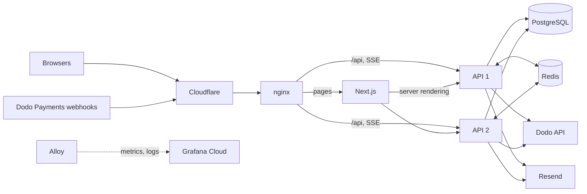

# Gatepass

Reserved-seat ticketing built for the moment a show goes on sale: thousands of buyers grabbing the same seats at once, with zero oversells, real test-mode payments, a live seat map and exactly-once check-in at the door.

**Live:** [gatepass.navraj.dev](https://gatepass.navraj.dev) (Dodo Payments test mode, no real money moves). Demo accounts: `organizer@gatepass.test`, `staff@gatepass.test` and `attendee@gatepass.test`.

## Results

Measured on the production VPS with two API instances, k6 running from a separate machine. Each run ends with [`load/audit.sql`](load/audit.sql), which must read 0 on every check.

| Measure                                | Result                      |
| -------------------------------------- | --------------------------- |
| Concurrent buyers in the on-sale spike | _to be measured on the VPS_ |
| Seats sold, oversells                  | _to be measured_ / **0**    |
| Hold p95                               | _to be measured_            |
| Live map viewers, update lag p95       | _to be measured_            |
| 5xx during a rolling deploy            | _to be measured_            |
| VPS                                    | _size_                      |

A laptop baseline (one API process, PostgreSQL, Redis and k6 sharing 12 threads) and the two bugs the first runs found are written up in [`load/README.md`](load/README.md). The short version: 5,000 buyers in 30 seconds saturated the single process, and still every audit check read 0.

## Architecture



| Part                                | Why it is there                                                                                                                 |
| ----------------------------------- | ------------------------------------------------------------------------------------------------------------------------------- |
| Cloudflare                          | TLS, DNS and DDoS protection in front of one public IP.                                                                         |
| nginx                               | One origin for pages and API, `least_conn` across two API instances so long-lived streams spread evenly, buffering off for SSE. |
| Next.js                             | One app for attendee, organizer and staff pages.                                                                                |
| API x2 (Express 5, TypeScript, Zod) | Stateless, so one can restart while the other serves: deploys never drop the API, SSE or webhooks.                              |
| PostgreSQL                          | Decides every seat. Row locks, constraints and partial unique indexes enforce the rules, not application code.                  |
| Redis                               | Relays seat changes between the two instances and holds rate-limit counters. Nothing in it must survive a restart.              |
| Dodo Payments                       | Hosted checkout, refunds and signed webhooks without touching card data.                                                        |
| Alloy and Grafana Cloud             | Metrics and logs leave the box, so monitoring outlives the VPS.                                                                 |

## How zero oversells works

Three layers, each enough on its own for the case it covers.

1. **Holds are one statement.** `holdSeats` locks the requested rows in id order (`FOR UPDATE`, so two buyers asking for overlapping seats in different orders cannot deadlock), checks each is available or its hold has lapsed, and sets `held_by` and `held_until` in the same `UPDATE`. All or nothing; a 2-second lock timeout turns contention into a clean 409. A per-buyer advisory lock enforces the 6-seat cap.
2. **Hold state is derived, not swept.** A seat is held while `held_until > now()`. No background job releases expired holds, so there is no window where a lapsed hold is still treated as taken, and no job to fall behind.
3. **The database refuses a second ticket.** `tickets_one_valid_per_seat` is a partial unique index on `seat_id where status = 'valid'`. If everything above failed, the insert fails, the order goes to refunding, and `oversell_attempts_blocked_total` counts it.

The concurrency suite runs on real PostgreSQL in CI on every pull request:

| Test | Must hold                                                                                                   |
| ---- | ----------------------------------------------------------------------------------------------------------- |
| C1   | 200 parallel holds on one seat: exactly 1 success, 199 clean 409s                                           |
| C2   | Overlapping multi-seat holds in opposite orders: all or nothing, no deadlocks                               |
| C3   | An expired hold is taken by a second buyer; the first buyer's checkout is refused                           |
| C4   | The same `payment.succeeded` delivered 10 times in parallel: one paid order, one ticket per seat, one email |
| C5   | Payment arrives after the hold lapsed and the seat was resold: order refunds, no second ticket              |
| C6   | 50 parallel scans of one ticket: exactly one green                                                          |
| C7   | 10 parallel "Pay" clicks: one pending order, one checkout session                                           |
| C8   | Refund, then resell the seat: the new ticket is allowed                                                     |
| C9   | Cancel races payment: paid with tickets, or refunding; never tickets for released seats                     |

## Payments

- **Checkout:** the order is created with a 15-minute Dodo session and the holds are extended to match plus 5 minutes of grace. The buyer pays on Dodo's hosted page.
- **Webhooks are the only truth.** The return URL carries a status for every outcome and is not trusted; the return page polls our API until the webhook has settled the order. Webhooks are verified with the Standard Webhooks signature over the raw body.
- **Idempotent by state, not by message id.** Fulfillment claims the order with a state-checked update inside one transaction, so a webhook delivered ten times changes things once. It also checks that the settled amount minus tax equals the order amount.
- **Late payments refund themselves.** A payment is not tied to the hold clock. If it lands after the seat was resold, the order goes to refunding, Dodo refunds it, and the buyer gets a "seat lost" email.

What the Dodo spike found before any of this was built is in [`docs/spikes/dodo.md`](docs/spikes/dodo.md).

## Live seat map

Server-Sent Events, not WebSockets: updates flow one way, SSE reconnects by itself, and it passes through Cloudflare and nginx as plain HTTP. Each stream subscribes before reading its snapshot, so no change falls in the gap. Changes are coalesced into 250 ms batches (last state wins), and held seats carry `heldUntil` so browsers turn them available on their own when a hold lapses. When Redis reconnects or an instance shuts down, streams close with a retry hint and browsers resync from a fresh snapshot. The map is a view: a stale seat costs a buyer a 409, never an oversell.

## Check-in

Ticket codes are 128 random bits in Crockford base32 (26 characters, forgiving of O/0 and I/1 when typed). A scan is a single conditional `UPDATE ... where scanned_at is null`, so of 50 simultaneous scans exactly one comes back valid and the rest report who scanned it and when. Staff see only the events they are assigned to.

## Decisions

- **PostgreSQL decides, Redis relays.** Redis locks would add a second source of truth that can disagree with the database. Row locks and constraints are already transactional.
- **No job queue.** Emails and refunds run after commit; failures are visible (metrics, a resend button, a retryable refunding state) instead of retried in the background. A queue (BullMQ) is the first thing to add at real scale.
- **`held_by` has no foreign key.** The hold `UPDATE` is the hottest write in the system, and a foreign key would add a lookup and a share lock on the buyer's user row for every seat.
- **Better Auth inside the API, sessions in PostgreSQL.** Revoking a session is deleting a row and takes effect on the next request; there is no signed-cookie cache that would keep a revoked session alive.
- **One Next.js instance.** A deploy blips pages for a few seconds; the API, SSE and webhooks stay up.
- **Biome instead of ESLint and Prettier.** The API compiles with TypeScript 7, which has no JavaScript API yet, so typescript-eslint cannot run. The web app stays on TypeScript 6 for the same reason, because Next.js needs that API.
- **Load tests never call Dodo.** `LOAD_TEST=true` swaps checkout creation for a stub and accepts bearer session tokens; k6 signs the payment webhooks itself, so the real verification and fulfillment code runs.

## Operations

- **Deploys:** pushing to `main` runs CI and pushes both images to GHCR tagged with the commit. [`infra/deploy.sh`](infra/deploy.sh) migrates, restarts `api-1`, waits until nginx trusts it again, then `api-2`. A local run under steady load served 8,328 requests through a full deploy with no errors.
- **Shutdown:** on SIGTERM an instance reports not ready, ends its SSE streams with a retry hint, finishes in-flight requests and exits within 10 seconds.
- **Observability:** Prometheus metrics for holds, payments, scans, SSE connections and update lag, oversells blocked and the connection pool; JSON logs with one request id from nginx through the API. The "On-sale night" dashboard and alert rules are in [`infra/grafana`](infra/grafana).
- **Backups:** nightly `pg_dump` to object storage with an alert if a night is missed. Restore steps and everything else are in the [runbook](infra/runbook.md).

## Limitations and next steps at scale

One VPS is not high availability. Next would be PostgreSQL replicas with failover, Redis Sentinel, a job queue for emails and refunds, a virtual waiting room in front of the on-sale, and an orchestrator for multi-node deploys. Prices are in USD because Dodo's pay-what-you-want products require it.

## Run it locally

Needs Node 24, pnpm 10 and Docker.

```sh
docker compose up -d
pnpm install
cp apps/api/.env.example apps/api/.env   # then set BETTER_AUTH_SECRET
pnpm --filter @gatepass/api db:migrate
pnpm --filter @gatepass/api db:seed     # wipes local data, creates the demo accounts and event
pnpm dev:api                            # http://localhost:4000, API docs at /api/docs
pnpm dev:web                            # http://localhost:3000
```

Demo password locally: `gatepass-demo`. Paying needs a Dodo Payments test-mode account in `.env`; everything else works without one. `pnpm test` runs the API suite against the `gatepass_test` database that compose creates, and `pnpm lint` and `pnpm typecheck` cover the whole repository.

```
apps/api        Express API, Drizzle schema and migrations, tests
apps/web        Next.js app
packages/shared Zod schemas and types used by both
infra           nginx, Alloy, Grafana, deploy and backup scripts, runbook
load            k6 scenarios, SSE viewers, SQL audit
```
